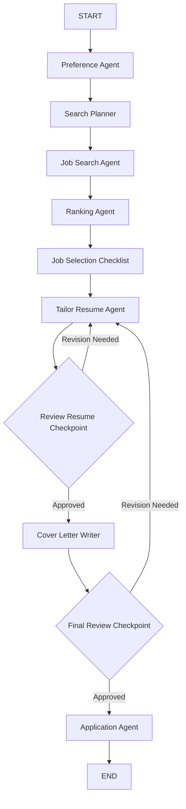

# 🤖 Multi-Agent Autonomous Job Search System

A highly structured, state-driven backend architecture that automates your end-to-end job hunting loop. Built with **LangGraph**, **FastAPI**, and **Google Gemini**, this system orchestrates a graph of specialized, collaborative agents that analyze your resume, scrape live job boards, score opportunities, and generate tailored, ATS-compliant materials.

---

## 🏗️ System Architecture & Agent Graph

The system coordinates **8 specialized agents** utilizing LangGraph's state machine management with native human-in-the-loop validation checkpoints (`interrupt`):



### Core Agents breakdown:
* **`resume_agent`**: Parses raw text strings extracted from uploaded PDFs and structures profile nodes without inventing details.
* **`preference_agent`**: Intercepts workflows to gather explicit target roles and geographic filters.
* **`search_planner`**: Optimizes raw programmatic search queries targeted for search engines.
* **`job_search_agent`**: Interfaces with the live Google Jobs engine using SerpAPI arrays.
* **`ranking_agent`**: Scores listings dynamically against candidate competencies using LLMs.
* **`tailor_resume_agent`**: Reorganizes text structures to fit target ATS parsers dynamically using contextual feedback loops.
* **`cover_letter_agent`**: Generates highly targeted, concise application introductions.

---

## 🛠️ Technical Stack
* **Orchestration Core:** LangGraph (`StateGraph`, `interrupt`, `Command`)
* **Intelligence Layer:** Google GenAI (`gemini-3.6-flash`)
* **External Integrations:** SerpAPI (Google Jobs Engine), PyMuPDF
* **Environment Configuration:** Python-dotenv

---

## ⚙️ Requirements & Local Environment Configuration

Before running the workflow, make sure you configure your authentication configurations in an uncommitted `.env` file.

### 1. Initialize Secrets Configuration
Create a `.env` configuration file in the project root folder:
```text
# Gemini Model API Access
LANGCHAIN_GOOGLE_GENAI_API_KEY=your_gemini_api_key_here

# Live Job Scraping Access
SERPAPI_API_KEY=your_serpapi_key_here

# Default Fallback Application Parsing Location (Optional)
RESUME_PATH=path/to/default/resume.pdf
```

### 2. Dependency Management Initialization
Install the precise dependencies required to parse documents and manage graphs:
```bash
pip install langgraph langchain-google-genai pymupdf serpapi python-dotenv
```

---

## 🏃 Launching your Workflows

### Standard Interactive Terminal Mode
You can execute the local multi-agent loop directly from your environment shell by supplying a runtime argument pointing to your master PDF:

```bash
python graph.py path/to/your/resume.pdf
```

### Operational Framework Details
1. **Resume Structuring:** The graph boots, reads the PDF matrix with `pymupdf`, and structures metadata records.
2. **Preference Collection:** The system pauses runtime with an `interrupt` block asking you for your target job descriptions.
3. **Automated Search & Evaluation:** The planner searches for jobs, filters them, and ranks them by match accuracy.
4. **Human Review Loops:** The system presents the ranked matches for selection and pauses again to let you accept or refine resumes and cover letters before completing execution.

---

## 📂 Repository Organization
* `graph.py` — Complete agent topologies, state typing schemas, and CLI workflows.
* `api.py` — Live API endpoints and request router entries.
* `auth.py` — Internal security layers and context verification handlers.
* `database.py` — Storage access boundaries and data mapping persistence engines.
